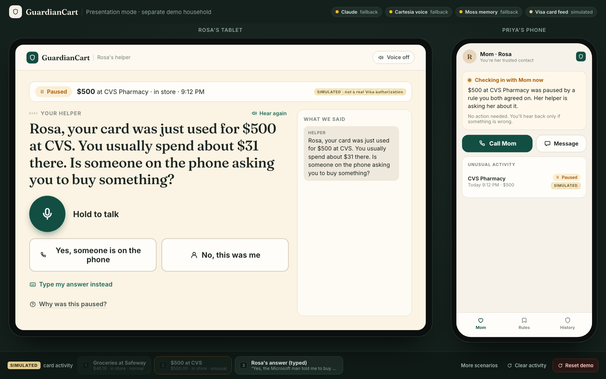
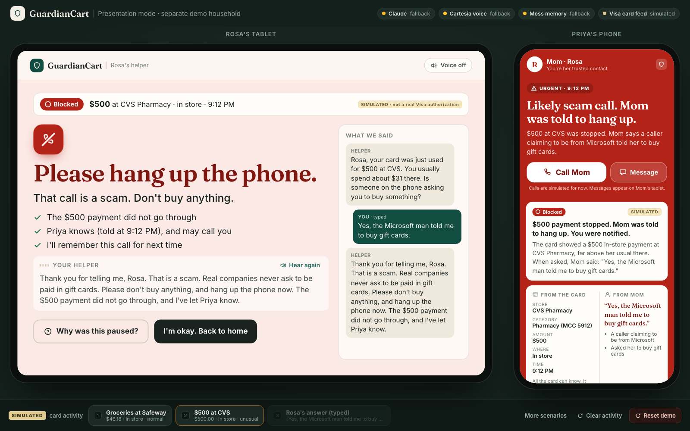
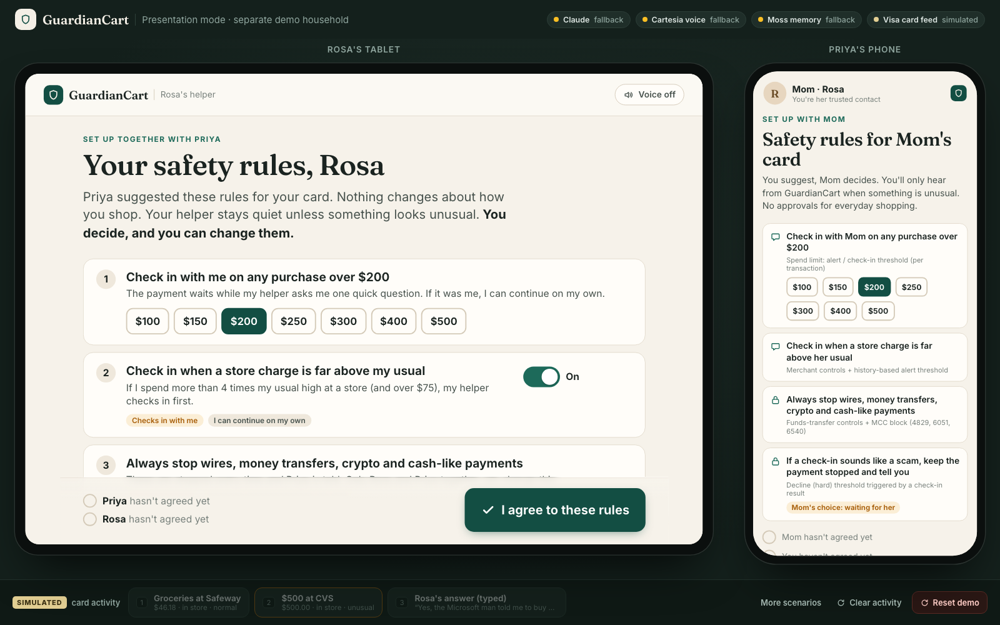
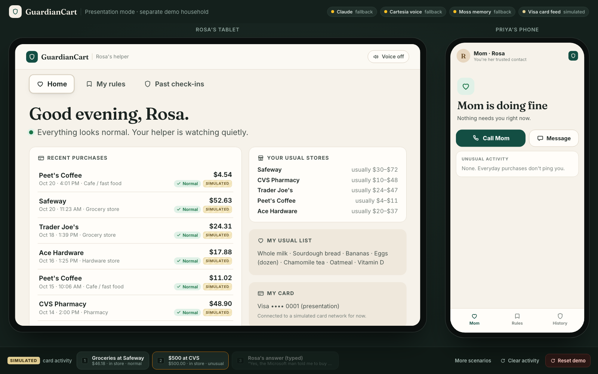
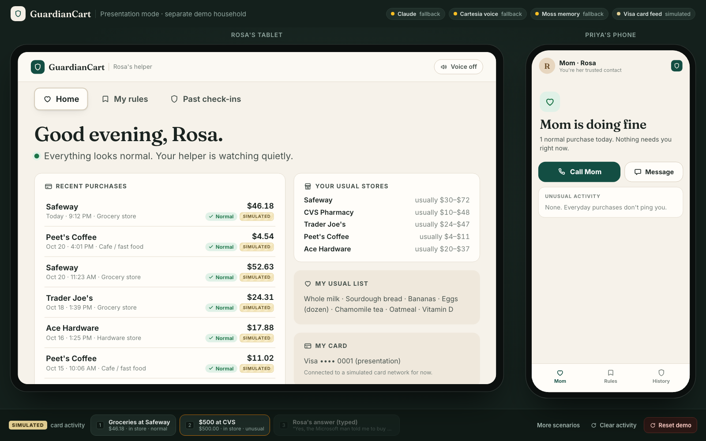
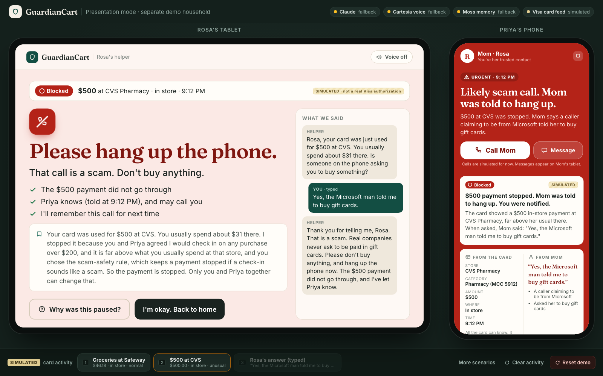

# 🛡️ GuardianCart

**A voice-first payment safety helper that stops phone scams at the moment of payment, while older adults stay in charge of their own money.**

Built at **Cal Hacks 13.0**  ·  React + Node/TypeScript  ·  Claude · Cartesia · Moss  ·  Visa-style transaction controls

---

## What is GuardianCart?

Scammers call older adults pretending to be tech support, the government, or a grandchild in trouble, and pressure them to pay *right now*, often by buying gift cards at a store. Today's safety nets miss this:

- A bank text asks *"Did you make this purchase?"* A victim being coached on the phone answers **"Yes."**
- Family members usually find out **weeks later**, after the money is gone.

GuardianCart sits at the **card payment**. When something unusual happens, it pauses that one payment under rules the older adult agreed to, and asks the question that actually exposes a scam:

> 🗣️ ***"Is someone on the phone asking you to buy something?"***

If the answer shows a scam, the money stays stopped, they are told to hang up, and their family is alerted immediately. Everyday purchases never interrupt anyone.

---

##  Rosa's story

> Rosa and Priya are fictional personas. All card activity in this project is **simulated**.

**Rosa is 78.** She lives on her own, shops at Safeway and CVS like she always has, and doesn't want anyone controlling her money. Her daughter **Priya** lives two hours away and worries.

**1. They agree on the rules together.**
Priya proposes a few safety rules, for example *"check in with me when a pharmacy purchase is far above my normal."* Rosa reads them, changes what she wants, and **co-signs** them herself. Nothing is imposed on her.

**2. Normal life stays normal.**
Rosa buys $46 of groceries at Safeway.  Approved instantly. No alerts, no approvals, nobody is bothered.

**3. Then the phone rings.**
A man claiming to be from "Microsoft" says her computer is hacked and she must pay with gift cards. Rosa goes to CVS and tries to spend **$500**, far more than she ever spends there.

**4. GuardianCart pauses that one payment** and Rosa's tablet speaks slowly and clearly, with large captions:
*"Rosa, your card was just used for $500 at CVS. Is someone on the phone asking you to buy something?"*

**5. Rosa answers in her own words**, by voice, a big button, or typing:
*"Yes, the Microsoft man said to buy gift cards."*

**6. GuardianCart recognizes the scam pattern.**
- Rosa hears: *"Thank you for telling me, Rosa. That is a scam. … Please don't buy anything, and hang up the phone now. The $500 payment did not go through, and I've let Priya know."*
- The payment stays **blocked** under the rule she signed.
- **Priya's phone turns red**, showing what the card saw (*CVS, pharmacy, $500, in-store*) separately from what Mom said, plus the full conversation and a **Call Mom** button.

**If it was a genuine purchase** (*"No, this was me, I'm buying a new blood-pressure monitor"*) and no hard rule applies, Rosa simply continues on her own. No one has to approve it.

**Rosa keeps her independence. Priya gets peace of mind. The scammer gets nothing.**

---

## Screenshots

**The check-in:** the $500 CVS payment is paused, and Rosa is asked the one question that matters.



**The scam is caught:** Rosa is told to hang up and the payment is blocked, while Priya's phone turns red with what the card saw, what Mom said, and a Call Mom button.



<details>
<summary><b>See the full flow (4 more screens)</b></summary>

**1. Rosa and Priya review the safety rules together**


**2. Both agree to the rules**


**3. A normal grocery purchase goes through without interrupting anyone**


**4. Rosa can always ask "Why was this paused?"**


</details>

> Screenshots are from presentation mode (`/stage`), running without API keys, so the status badges show the built-in fallbacks. All card activity is simulated.

---

## Why it matters for society

Elder fraud is large and growing:

| | |
|---|---|
| **$4.885 billion** | lost by people 60+ in 2024, reported to the FBI, **up 43%** from 2023 ([FBI IC3 2024, p.27](https://ic3.gov/AnnualReport/Reports/2024_IC3Report.pdf)) |
| **$982 million** | lost by people 60+ to tech-support scams alone ([FBI IC3 2024, p.28–29](https://ic3.gov/AnnualReport/Reports/2024_IC3Report.pdf)) |
| **5×** | people 60+ are five times more likely to report losing money to tech-support scams ([FTC, 2025](https://www.ftc.gov/system/files/ftc_gov/pdf/P144400-OlderAdultsReportDec2025.pdf)) |
| **Gift cards** | the most frequent payment method in tech-support, government-impersonation, romance and family-impersonation scams ([FTC, 2025](https://www.ftc.gov/system/files/ftc_gov/pdf/P144400-OlderAdultsReportDec2025.pdf)) |
| **63 million** | U.S. family caregivers, nearly 1 in 4 giving 40+ hours a week ([AARP, 2025](https://www.aarp.org/press/releases/2025-07-24-new-report-reveals-crisis-point-for-americas-63-million-family-caregivers.html)) |

**How GuardianCart helps:**

-  **Stops losses before they happen.** It intervenes at the payment itself, not weeks later, and not by monitoring phone calls.
-  **Protects independence and dignity.** Older adults strongly prefer managing their own finances ([NYU Stern](https://www.stern.nyu.edu/sites/default/files/assets/documents/Ind_Myth_Exec_Summary_rev_050417.pdf)). Rosa co-signs every rule, can always ask *"Why was this paused?"*, and her family receives alerts but never becomes an approver.
-  **Reduces caregiver stress.** Families get one meaningful alert at the moment it matters, instead of constant pings or taking over a parent's bank account.
-  **Accessible by design.** Voice-first, slow and calm speech, large captions and big buttons. Typing and quick replies always work as alternatives.
-  **Builds trust in AI for payments.** The AI only *analyzes*; fixed, auditable rules make every money decision (see below).

> **Honest scope:** GuardianCart targets the card and gift-card slice of elder fraud. The largest total losses go through bank transfers and crypto (FTC), which this project does not cover.

---

## ⚙️ How it works

```
 Card payment ──► Transaction provider ──► Policy engine (co-signed rules)
                                               │
                          normal ◄─────────────┼─────────────► unusual
                        approve              │             pause + voice check-in
                                               ▼
                               Rosa answers (voice / button / text)
                                               │
                                 Claude analyzes the answer
                            (risk signal only, can never move money)
                                               │
                              Policy engine decides, fixed code acts
                                 │                          │
                         genuine: Rosa continues    scam: blocked,
                                                        Rosa told to hang up,
                                                        Priya alerted 
```

### Safety by design

- **AI analyzes → rules decide → code acts.** Claude turns Rosa's answer into a structured risk signal (risk level, scam pattern, plain-language reason). The deterministic policy engine in `shared/policy.ts` makes the decision. Claude **never** approves, releases or blocks money, its output is whitelisted and can only *raise* risk, and every payment-status sentence is fixed code.
- **Honest data sources.** The card only knows merchant, category, amount, channel and time. It never sees items. Words like *"gift cards"* come only from Rosa's answer, and the UI always labels **From the card** vs **From Mom** separately.
- **Works without AI.** Every sponsor service is optional. Without API keys, it falls back to a deterministic scam-phrase classifier, template speech and browser voice.

---

##  Features

**For Rosa (tablet):**
- Reviews, edits and co-signs safety rules on first run
- Home screen with recent purchases marked **Normal / Paused / Blocked** (tap any one to see why)
- Spoken check-ins with large captions; answer by voice, button or typing
- Suggests rule changes (they take effect only when Priya agrees, and vice versa)
- History of every check-in, and messages from Priya with *I'm okay* / *Please call me* replies

**For Priya (phone):**
- Calm *"Mom is doing fine"* status. No approvals and no pings for everyday purchases
- Urgent red alert only when a rule blocks a payment or a scam is flagged: card facts vs Mom's words, the rules that applied, the transcript and the timeline
- **Call Mom** (simulated) or message Mom's tablet, then *Mark as handled*
- Rules and full incident history

---

##  Quick start

Requires **Node.js 20.4+**.

```bash
git clone https://github.com/tejkiranyenugunti-spec/Guardian-Cart.git
cd Guardian-Cart
npm install
npm start              # builds the web app and serves everything on http://localhost:8787
```

| Screen | URL |
|---|---|
| Start page | http://localhost:8787/ |
| **Rosa** (tablet) | http://localhost:8787/rosa |
| **Priya** (phone) | http://localhost:8787/family (same Wi-Fi: `http://<laptop-ip>:8787/family`) |
| Card network simulator | http://localhost:8787/card-simulator |
| Presentation mode (separate demo household with Reset) | http://localhost:8787/stage |

Add `?mute=1` to any URL to silence voice on that screen.

### Try it: send simulated card transactions

```bash
npm run txn -- --merchant "Safeway" --mcc 5411 --amount 46.18          # approved (normal)
npm run txn -- --merchant "CVS Pharmacy" --mcc 5912 --amount 500       #  paused, Rosa gets a check-in
npm run txn -- --merchant "QuickWire" --mcc 4829 --amount 900 \
               --type funds_transfer --channel online                  #  blocked
```

Or use `/card-simulator`, or POST directly:

```bash
curl -X POST localhost:8787/api/transactions -H 'content-type: application/json' \
  -d '{"transaction_id":"t-1","merchant":"CVS Pharmacy","merchant_category":"5912","amount":500,"channel":"in_store","transaction_type":"purchase"}'
```

Event fields: `transaction_id, card_id, merchant, merchant_category (MCC), amount, currency, timestamp, transaction_type (purchase | funds_transfer | quasi_cash | cash_withdrawal), channel (in_store | online)`. Duplicate `transaction_id`s are ignored.

---

##  Configuration (all optional)

Copy `.env.example` to `.env` and fill in whatever you have:

| Variable | Powers | Fallback without it |
|---|---|---|
| `ANTHROPIC_API_KEY` | **Claude** writes the spoken question (Haiku) and analyzes Rosa's answer into a risk signal (Sonnet) | Template sentence + deterministic scam-phrase classifier |
| `CARTESIA_API_KEY`, `CARTESIA_VOICE_ID` | **Cartesia** slow, calm Sonic voice and Ink-Whisper push-to-talk | Browser speech synthesis and recognition |
| `MOSS_PROJECT_ID`, `MOSS_PROJECT_KEY` | **Moss** memory of Rosa's habits: usual stores and spending ranges, scam-script library, family rules, past incidents | Local in-process keyword memory with the same documents |

Set `GUARDIANCART_OFFLINE=1` to force every external service off and rehearse the fallback path.

---

##  Tests

```bash
npm test               # 58 tests: policy, classifier, flows, Claude misbehaving, pipeline, provider swap, persistence, rule changes
npm run verify         # Playwright end-to-end MVP check, including a real server restart
npm run typecheck
```

---

## ☁️ Deploy

**Render:** create a new **Web Service** from this repo with the **Docker** runtime, then add the optional keys above as environment variables. The server listens on `$PORT`.

**Docker:**

```bash
docker build -t guardiancart .
docker run -p 8787:8787 -v "$PWD/data:/app/data" --env-file .env guardiancart
```

Household data is stored in `data/<household>.json` (atomic writes, never secrets). On hosts without a persistent disk, it resets on redeploy; set `GUARDIANCART_DATA_DIR` to a mounted volume to keep it. Clear local data with `npm run reset:home` while the server is stopped.

---

##  Project structure

```
server/        Express API: transaction pipeline, guardian check-in flow, Claude agent, voice, memory, persistence
  transactions.ts   Transaction provider interface (simulated now; a Visa provider can be swapped in)
shared/        Code shared by server and web
  policy.ts         Deterministic policy engine: the only place money decisions are made
  classifier.ts     Offline scam-phrase classifier
web/           React app
  rosa/             Rosa's tablet screens (setup, home, check-in, rules, history)
  family/           Priya's phone app
  stage/            Presentation mode
tests/         Vitest suites
scripts/       Transaction sender, Playwright verification, screenshot and demo recorders
```

---

## Limitations

- **Simulated card network.** Transactions come from a simulator, not real Visa authorizations. `server/transactions.ts` defines a `VisaTransactionProvider` interface so a real Visa integration can replace the simulator without changing the policy engine or apps.
- **Demo household.** One hard-coded family, no authentication. Not for real financial use.
- **Synthetic data.** Rosa's year of purchase history is generated, and labeled as such.

---

*GuardianCart was built at Cal Hacks 13.0 to show that AI can protect people's money while keeping humans, and fixed, auditable rules, in charge.*
